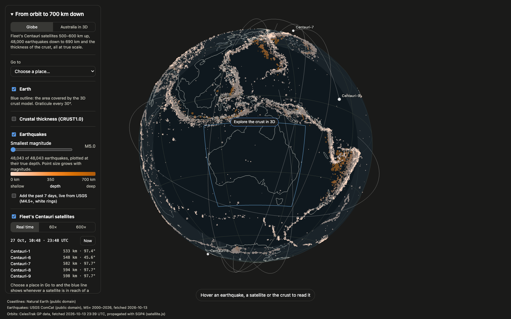
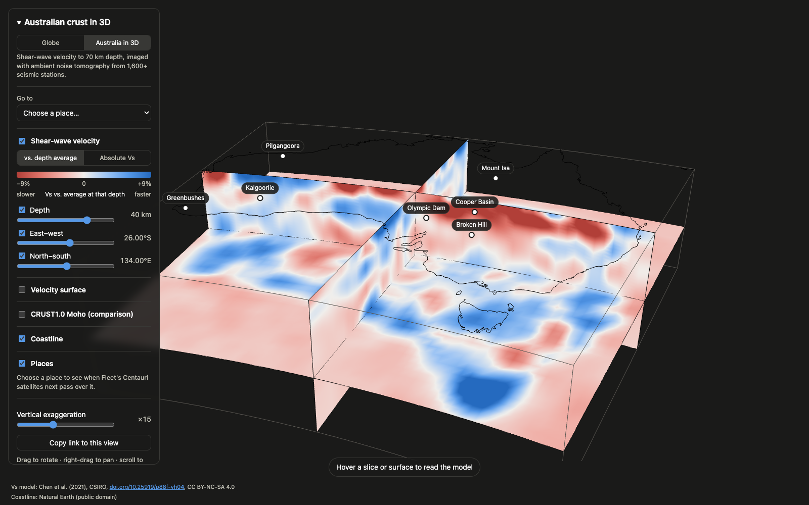

# geos: from orbit to the crust

**Live: [geos.notnav.workers.dev](https://geos.notnav.workers.dev)**

<p>
  
  
</p>

*Left: the globe, with earthquakes since 2000 (deeper in darker orange) and Fleet's satellites live. Right: Australia in 3D, slicing the crust to 70 km.*

An interactive 3D viewer with two views. It opens on a **globe** at true scale: Fleet Space's Centauri
satellites 500–600 km up, 48,000 earthquakes down to 690 km, and the thickness of the crust. From there it
flies into **Australia in 3D**: a published shear-wave velocity (Vs) model of the Australian crust, imaged
with ambient noise tomography from ~30 years of recordings at 1,600+ seismic stations.

**Globe**
- Earthquakes (M5+ since 2000) at their true depth, sized by magnitude and coloured by depth. The sinking plates under Tonga,
  Japan and the Andes show up as sheets of deep events. Optional live feed of the past 7 days from USGS.
- Fleet's Centauri satellites at their current positions with one orbit ahead. Pick a place and see every pass above 10°
  for the next 24 h, the longest wait between passes, and a line drawn whenever a satellite is in reach of a sensor there.
  Real time, 60× or 600×.
- Crustal thickness from CRUST1.0, the independent 1° global model.

**Australia in 3D**
- Drag depth, east–west and north–south slices through the model. Colour them by absolute Vs
  or by % difference from the average at each depth.
- Turn on a **velocity surface**: everything slower than a chosen Vs, coloured by depth.
  Presets: 3.2 km/s (sedimentary basins) and 4.2 km/s (a proxy for the base of the crust).
- Compare the 4.2 km/s surface with **CRUST1.0's Moho**. Over 781 land cells the two agree to a median 2.9 km.
- **Go to** a mineral district or basin (Olympic Dam, Mount Isa, Greenbushes…). The camera flies
  there, the slices cut through it, and the panel shows the next Centauri pass overhead.

Hover anything to read the data. Every view is in the URL, so **Copy link** shares exactly what you see.

## Data

| Layer | Source | License |
|---|---|---|
| Vs model | Chen, Saygin, Kennett, Tork Qashqai, Hauser, Lumley & Sandiford (2021), CSIRO, [doi:10.25919/p88f-vh04](https://doi.org/10.25919/p88f-vh04). Paper: *Nature Communications* 2023 | CC BY-NC-SA 4.0 |
| Earthquakes | [USGS ComCat](https://earthquake.usgs.gov/fdsnws/event/1/), M5+ earthquakes since 2000: 48,043 events in the bundled snapshot (fetched 2026-10-13; `npm run data` refreshes the current year), plus the live past-week feed | Public domain |
| Satellite orbits | [CelesTrak](https://celestrak.org/) GP data (OMM JSON) for `NAME=CENTAURI`, propagated with SGP4 ([satellite.js](https://github.com/shashwatak/satellite-js)) | See CelesTrak's [usage policy](https://celestrak.org/NORAD/documentation/gp-data-formats.php) |
| Crust | CRUST1.0, Laske, Masters, Ma & Pasyanos (2013), [igppweb.ucsd.edu/~gabi/crust1](https://igppweb.ucsd.edu/~gabi/crust1.html) | No license stated; cited |
| Coastlines | [Natural Earth](https://www.naturalearthdata.com/) 1:50m (Australia), 1:110m (globe) | Public domain |

The Vs grid is 56 lon × 45 lat × 31 depth (0.75°, 0.25–70 km, depth spacing non-uniform).
The viewer draws one vertex per grid node and does no resampling. `public/data/vs.json`
is derived from the CSIRO data, carries its citation and license, and is shared under
the same CC BY-NC-SA 4.0 terms.

## Run

Requires Node 22.18+ (the self-checks run TypeScript directly) and `unzip` (used by `npm run data`).

```bash
npm install
npm run dev        # http://localhost:5173 (satellites come from the bundled snapshot)
npm run data       # re-download raw files and rebuild public/data/*.json (asserts every row)
npm run check      # projection, isosurface, CRUST1.0 lookup and satellite self-checks
npm run build      # type-check app + Worker, build to dist/
npx wrangler dev --test-scheduled   # site + Worker locally; GET /__scheduled runs the cron
npm run deploy     # build + deploy to Cloudflare Workers
```

Live at **https://geos.notnav.workers.dev**. Until the cron first runs after a deploy, `/api/satellites` serves the bundled snapshot.

Forking? Delete the `id` from the `ORBITS` binding in `wrangler.jsonc`; your first `npm run deploy` then creates your own KV namespace.

## How it fits together

- `pipeline/prepare.mjs` turns raw downloads into static JSON (~2.6 MB) and asserts on every source:
  grid order and extents, USGS row counts per year, CRUST1.0 cell order.
- `worker/index.ts` serves the site plus `GET /api/satellites`. A cron trigger (every 4 h) fetches Fleet's orbits
  from CelesTrak into KV, so visitors never contact CelesTrak. That matters because since March 2026 CelesTrak
  allows one download per data update per user and firewalls repeated errors. On any error the Worker keeps
  the last good copy.
- `src/project.ts` has the two frames: `project()` (Albers equal-area for Australia) and `projectGlobe()` (true-scale
  sphere). Every layer places geometry through one of them, so layers in a view line up.
- `src/sats.ts` covers SGP4 positions, look angles and pass prediction. Checked against Heavens-Above:
  Centauri-7 over Olympic Dam, six passes, rise and set within 1 s, peak elevation within 1°.
- `src/layer.ts` defines the layer contract: a hook returning `{ id, label, scene, controls?, credit? }`.
  `App.tsx` keeps one layer list per view; all hooks run in both views and only the current view's layers draw.
- `src/url.ts` mirrors view state (view, slices, mode, surfaces, filters, speed, both cameras, hidden layers) into the URL hash.
- **Adding a layer** = one new file in `src/layers/` and one entry in the right view's array in `src/App.tsx`.

Built with React, @react-three/fiber, three.js, satellite.js and Vite, deployed on Cloudflare Workers.

## License

Code: [MIT](LICENSE). The data files in `public/data/` keep their sources' licenses (see [Data](#data)).
`vs.json` is derived from the CSIRO model and shared under CC BY-NC-SA 4.0, so it can't be used commercially.
